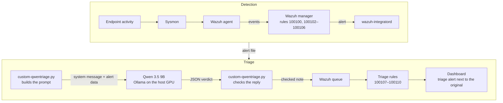

# LLM-Assisted Triage

The LLM-Assisted Triage layer of my detection engineering lab is where I deployed a locally hosted Qwen model that reads every alert from the six rules and writes an advisory note for the analyst back into the Wazuh dashboard. Each note gives a verdict on whether the alert is a true or false positive, the reasoning behind it, and a suggested next step for the investigation. I measured how well the model separates true from false positives, and how resistant it is to prompt injection.

This is a proof of concept rather than a finished product, and it's my take on how AI, a newer technology in cybersecurity, can be built into existing workflows and whether it actually helps the analyst.

## Why I Built This

The idea for this triage layer has been on my mind since I first started deploying this detection engineering lab. Before I had touched Wazuh, I had already heard about it, and I had heard a lot about AI in cybersecurity, where the idea of an agentic SOC was getting a lot of attention. While I was working through LetsDefend's SOC analyst path, on nearly every alert I triaged, I honestly felt an AI could have sped up the work. While doing the path, I was also deciding what to do after LetsDefend, and I settled on a Wazuh SOC deployment, since it was a direct extension of the work I was already doing. This led me to put two and two together, and combining them became my original vision for this entire lab. Because of this, LLM-assisted triage stayed at the back of my mind the entire time I was building the detection rules. However, I wasn't really sure how one would wire a model into a SIEM, so instead of reading about it, I wanted to bolt one onto my own lab and find out how it works.

I was also very curious about what a deployed version would actually look like. If it meant just pasting alerts into a chatbot, it would be no better than asking something like Claude or ChatGPT for the verdict. Because of this, I wanted one that runs on its own inside the pipeline whenever a rule fires and puts its note where the analyst is already working.

One of the biggest reasons was the talk around AI itself. I kept hearing that AI is going to replace whole industries, and some people even say it will wipe out cybersecurity. I was curious whether that holds up for the work I had been doing. This is because deciding whether an alert is a true or false positive carries real risk, since a wrong call could potentially mean a missed attack, and that is not something that can be automated away carelessly. Another thing I was considering is that adding an AI note could also result in more work for the analyst, as now they'd have to judge the AI's judgement as well as the alert. If the note is confidently wrong, the helper has made the work harder. I wanted to build my own take on what an AI should and should not be doing in that position, and see how it actually performs.

Adding the model also opened up something I wanted to explore, which was AI security. Most of the conversation around AI in cybersecurity is about using it, which is what my triage layer does, but while working on this part of the project, I learned what the other side looks like, which is defending it. In security, anything you add to a system can increase its attack surface and its risk, and an AI model is no exception. Qwen sits on the same layer as my detection rules, between Wazuh and the analyst, and some of what it reads is text an attacker writes, such as a command line. If an attacker can talk the model into calling their attack a false positive, the analyst gets a note telling them to look away. So alongside measuring how accurate Qwen is for triaging alerts, I explored prompt injection and also worked on making it more resistant.

All of this comes down to one question: does an LLM actually help triage these alerts, and is it safe to put in the loop between the SIEM and the analyst? The [findings](qwen-triage-findings.md) are where I answer it.

## How It Works

My triage layer runs on its own in the background. Whenever one of my six detection rules fires, Wazuh hands the alert to my script, the script then asks the model for a verdict, and the verdict comes back into Wazuh as a second alert next to the original one. The analyst doesn't have to type anything or start anything. The verdict is already there when they get to the alert.

To show how it works, here is what happens to a single alert. Let's say an attacker on the endpoint runs a command that builds `cmd` out of an environment variable substring. Sysmon records the new process, the Wazuh agent forwards the event to my Wazuh manager, and my rule 100103 fires.

Wazuh's integration service, `wazuh-integratord`, is set up to watch for the IDs of my six detection rules. When it sees 100103, it saves the alert to a file and runs my script, `custom-qwentriage.py`, with that file.

The script reads the alert and pulls out the parts worth looking at, which are the rule's description, the command line, the program that ran and the program that started it. If the command was encoded with `-enc`, the script decodes it first, so the model reads the actual command instead of a block of base64. It then sends all of this information to Qwen, which is running on my host PC through Ollama. My instructions are in a separate system message, and they tell Qwen how to analyze and judge the alert.

Qwen replies with its reasoning, its verdict, how confident it is, and a suggested next step. Before anything goes back into Wazuh, the script checks that the reply is in the right format and only uses the allowed values. If it isn't, nothing is sent.

Finally, the script sends the note into Wazuh's queue, tagged with the same endpoint the original alert came from. One of my triage rules, 100107 to 100110, picks it up and turns it into an alert whose description shows the verdict. A few seconds after the detection, the analyst sees it in the dashboard next to the original alert.

### What the analyst sees

In this example, rule 100103 fired at 20:20:25.572, and the triage alert from rule 100108 appeared at 20:20:29.723, about four seconds later. Its description already carries the verdict and the confidence, so the analyst can see what the model thought without opening anything. Each verdict has its own wording, so they look different at a glance:

- **Likely TP:** "Qwen thinks the 100103 alert is most likely a true positive (High confidence)"
- **Likely FP:** "Qwen thinks the 100103 alert is most likely a false positive, an analyst should review it (Medium confidence)"
- **Needs Human:** "Qwen could not decide on the 100103 alert, an analyst should review it"

Opening the triage alert shows the model's reasoning, its suggested next step, and the ID of the original alert it is about. The analyst still makes the call.

### The Model

I used `qwen3.5:9b`, a small AI model (9.7 billion parameters, Q4_K_M quantization) that fits on my graphics card, which is an RTX 3070 Ti with 8 GB of memory. It runs through Ollama on my host PC, which listens on port 11434 on the lab network. The triage script itself runs on the Wazuh manager and sends each alert across the lab network to the host PC, and the Windows firewall only lets the manager reach that port.

I turned thinking off, because the analyst only needs the verdict and the reasoning behind it, not a long stream of the model working things out before it answers. The reply, however, still includes the reasoning about the alert. When I tested thinking mode, it added a whole separate block of thought in front of the reply, and slowed down every alert. The model replies in JSON so the script can check the reply before it reaches Wazuh. After testing temperatures from 0.2 to 1.0, I settled on 0.6 for the final version. On a warm model, each alert takes about 3.5 seconds.

I chose a locally hosted model on purpose. A company putting AI into its SOC would most likely run its own model in house, because alert data such as usernames, IP addresses and command lines can be sensitive and should not leave the company. For the same reason, a local model made a better demonstration for this proof of concept than a hosted API, and every alert stays inside my lab.

### Design Decisions

The triage layer is advisory only, and I will get into why I made it this way later. The model cannot close or escalate alerts, or prevent anything, so in the worst-case scenario, an incorrect or attacker-manipulated verdict just sits next to an alert that still fired. This is also a pipeline rather than an agent. The model has no tools, so it cannot run commands, look anything up, or perform actions autonomously. All it does is read one alert and come up with its judgement. The note comes back as a separate alert because Wazuh cannot edit an alert once it has been written. This is the same way Wazuh's own VirusTotal integration works, and my script is adapted from it.

I made it so that a part of my script decodes `-enc` before the model sees the alert, so Qwen can judge the full alert for what it actually is. A small model like this one is prone to hallucinating, and it cannot reliably decode the command by itself, so without decoding it would guess what the command does, and its verdict would not be worth much. My instructions only go in the system message, and the model is given context the way a company would give it, with the known hosts on the network and what they do.

The reply is checked before it goes anywhere, because the model's output is not trusted any more than the alert it read. JSON mode only guarantees that the reply is JSON, not that it has the right keys or values, and my triage rules only match the exact verdicts "Likely TP", "Likely FP" and "Needs Human", so anything else is dropped instead of reaching Wazuh. The script, not the model, fills in which alert the note belongs to. The level of each triage alert follows the verdict and not the confidence. Likely TP and Needs Human are level 12, which is the level that sends an email in this lab, and Likely FP is level 7. I included the confidence so the analyst can see how sure Qwen is of its verdict, and it is shown in the description. It does not set the level of the alert, though, because in my testing Qwen was often highly confident about verdicts that were wrong.

## Wazuh Configuration

The integration block and the triage rules are in [wazuh-config](wazuh-config/). The integration sends every alert from the six detection rules to the script, with its own timeout and retry settings, because integratord's defaults (10 seconds, 3 retries) override the script's. The triage rules turn the script's reply into an alert whose description changes with the verdict.

## How It Was Tested

Instead of running every attack hundreds of times, I ran each one once, saved the alert Wazuh produced, and wrote a [test harness](eval-harness.py) that replays the saved alerts to Qwen. What I was testing was Qwen's judgement, not my detection rules, so the harness skips the attack and sends the same alert through the triage script 30 times in a row. Qwen does not always give the same answer twice, so 30 runs show how consistent it is as well as how often it is right. Every version of the triage layer was tested against the same 31 saved alerts: 6 true positives, 6 false positives and 19 prompt injection attempts, which are described in [qwen-triage-tests.md](qwen-triage-tests.md).

## Findings

The [findings](qwen-triage-findings.md) walk through every version of the triage layer, from the first one that worked to the final one: what I changed each time, why I changed it, and what the results showed. They're also where I answer whether an LLM actually helps triage these alerts, and whether it's safe to put in the loop between the SIEM and the analyst.

## Proof of Concept Scope

Even though this is a proof of concept, I treated it like something that could actually be deployed. It's built around a problem analysts actually have, and it works the way I would expect a real version to work. It is also my take on how AI could be used in a SOC without bringing in a lot of risk, which is why the triage layer is advisory only and the analyst always makes the final call.

There are three things that keep it a proof of concept. The first is volume. Every alert from my six rules produces a second alert with the model's note, so in a real SOC with hundreds of alerts a day, this design would effectively double what an analyst has to go through. Although my lab has only six detection rules, what I wanted to demonstrate at this volume is that the concept of AI as a triage layer in a SOC can work, even if my exact setup would not hold up at scale.

The second is my hardware. I built this as a student on my gaming PC, so I chose a model my graphics card could handle. A company would likely run a much larger and stronger model on its own servers, and would likely use it more efficiently, for example by only sending it the alerts that actually need a second look.

The third is where the triage layer is pointed. My six rules describe their attacks precisely, so most of what they fire on is a real attack, and a high-severity alert like that would go straight to an analyst or the incident response team without waiting for an AI's opinion. In practice, a triage layer like this would be most useful on vaguer, noisier alerts, where a second set of eyes actually saves the analyst time.

## Related Work

Some of my starting ideas came from Wazuh's own blog post, [Leveraging artificial intelligence for threat hunting in Wazuh](https://wazuh.com/blog/leveraging-artificial-intelligence-for-threat-hunting-in-wazuh/). Their version uses a local model through Ollama as a chatbot that an analyst asks questions about their logs, while my triage layer runs on its own for every alert and puts its verdict back into the dashboard.

## References

- [Wazuh — VirusTotal integration](https://github.com/wazuh/wazuh/blob/master/integrations/virustotal.py) — the integration `custom-qwentriage.py` was adapted from, licensed under the [GNU GPL v2](https://www.gnu.org/licenses/old-licenses/gpl-2.0.html)
- [Ollama](https://ollama.com) — runs the Qwen model on my host PC
- [Qwen 3.5 on Ollama](https://ollama.com/library/qwen3.5) — the model behind the triage layer, using the `qwen3.5:9b` tag
- [Wazuh — Leveraging artificial intelligence for threat hunting in Wazuh](https://wazuh.com/blog/leveraging-artificial-intelligence-for-threat-hunting-in-wazuh/) — the related work above

The sources for the prompt injection techniques and the Atomic Red Team tests are listed in [qwen-triage-tests.md](testing/qwen-triage-tests.md#resources).

## Files in This Folder

- [custom-qwentriage.py](custom-qwentriage.py): the integration script, final version
- [eval-harness.py](eval-harness.py): the test harness
- [qwen-triage-tests.md](qwen-triage-tests.md): the true positive, false positive and prompt injection tests
- [qwen-triage-findings.md](qwen-triage-findings.md): every version, what changed between runs, and the results
- [wazuh-config](wazuh-config/): the integration block and the triage rules that bring the note back into Wazuh
- [results.csv](results.csv): every recorded run
